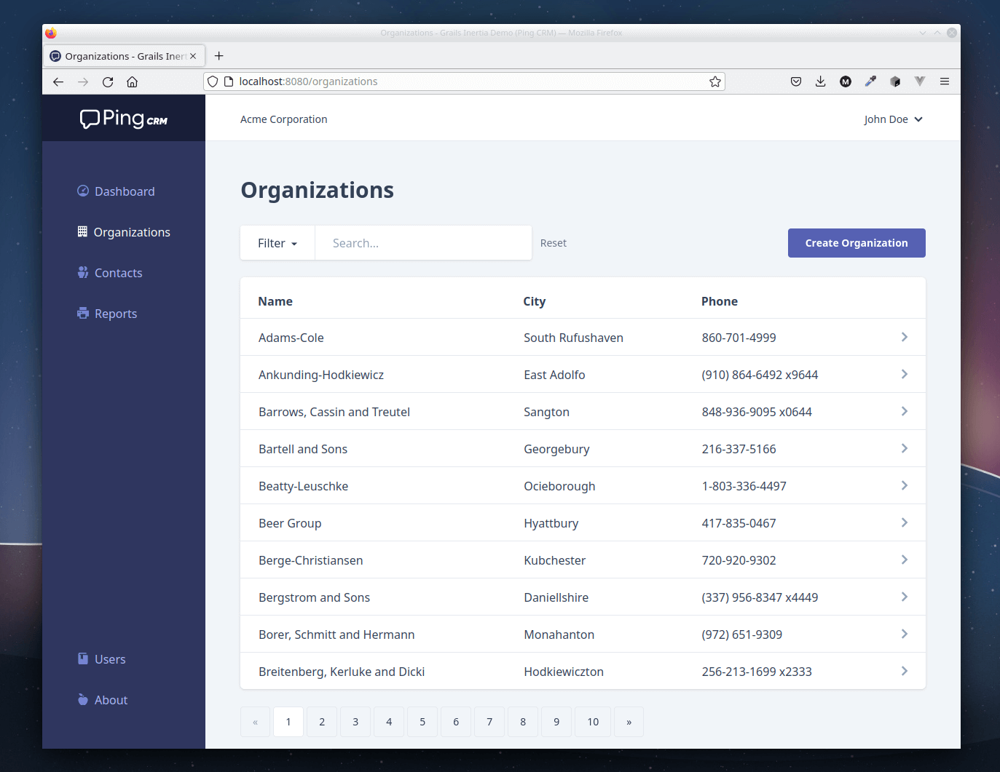

# 🖥️ Ping CRM on Apache Grails

[](https://github.com/matrei/pingcrm-grails/actions/workflows/gradle.yml)

A demo application built with **[Apache Grails](https://grails.apache.org)** and **[Vue.js](https://vuejs.org)** to illustrate how **[Inertia.js](https://inertiajs.com/)** works.\
It uses the [Grails Adapter for Inertia.js](https://github.com/matrei/grails-inertia-plugin) plugin.

>[!NOTE]
>This is a port to Apache Grails/Groovy of the [original Ping CRM](https://github.com/inertiajs/pingcrm) written in Laravel/PHP.



>[!NOTE]
> There is a live demo of this application at:
> **https://pingcrm.mattiasreichel.com**
> 
> The demo is running in a container that is destroyed/recreated at the top of every hour.\
>**Please be respectful when editing data!**

## ✨ Features

- The UI is in English and Swedish. The language is taken from the browser, and `?lang=en` or `?lang=sv` switches it for the session.
- Login with [Spring Security](https://spring.io/projects/spring-security), including remember me and CSRF protection.
- Optional server-side rendering (see SSR below).

## 📋 Requirements

- Java 21+
- Node.js 20.19+ or 22.12+ with npm (Node.js 24 is recommended).\
  The Gradle build downloads its own Node.js, so this is only needed for `npm install`, `npm run serve` and server-side rendering.
- Docker, for running the tests

## 📦 Installation

Clone the repo locally
```shell
git clone https://github.com/matrei/pingcrm-grails.git
cd pingcrm-grails
```
\
Install client dependencies
```shell
npm install
```
## 🏃 Running

### 🛠️ In development mode ...

Serve client files with [hot module replacement](https://vite.dev/guide/features.html#hot-module-replacement)
```shell
npm run serve
```
\
and start the grails application
```shell
./gradlew bootRun
```

### 🚀 ... or in production mode

with bundled/minified client files
```shell
./gradlew -Dgrails.env=production bootRun
```

### ✅ You're ready to go!

Visit Ping CRM in your browser - http://localhost:8080

## 🧪 Running tests

To run the Ping CRM test suite, run:
```shell
./gradlew check
```
The browser tests run Firefox in a Docker container ([Testcontainers](https://testcontainers.com)), so Docker must be running.

## 🔨 Build for production

To create a runnable war for production (in `build/libs`)
```shell
./gradlew assemble
```
that can be run with:
```shell
java -jar build/libs/pingcrm-grails-5.0.1-SNAPSHOT.war
```
The `-plain` war and jar next to it are not runnable.

## ⚙️ SSR

To run the application in server-side rendering mode, you need Node.js 20.19+ on the `PATH`, as the application starts the SSR server with `node`.

SSR is disabled by default. To enable it, set the `inertia.ssr.enabled` config property to `true` in `application.yml`,
or set the `INERTIA_SSR_ENABLED` environment variable to `true`.

The build writes the SSR bundle to `src/main/resources/ssr/ssr.js`, with its dependencies bundled into it.
When the application is started from the project root, it finds the bundle there.
You can change the location by setting the `inertia.ssr.bundle` config property.

To use SSR with the war, extract the bundle from it and point `inertia.ssr.bundle` to it:
```shell
unzip build/libs/pingcrm-grails-5.0.1-SNAPSHOT.war 'WEB-INF/classes/ssr/*' -d build/ssr
java -jar build/libs/pingcrm-grails-5.0.1-SNAPSHOT.war --inertia.ssr.enabled=true --inertia.ssr.bundle=build/ssr/WEB-INF/classes/ssr/ssr.js
```

## 🙏 Credits

* Original work by Jonathan Reinink (@reinink) and contributors
* Port to Apache Grails by Mattias Reichel (@mattias_reichel)
